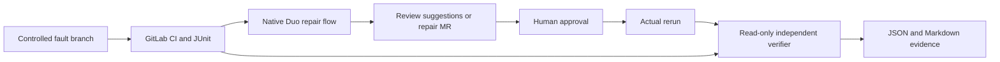

# GitLab implementation sequence

Target: October 27, 2026, 18:30 IST. Internal submission target: 12:00 IST.
Path A; provisionally Assisted. Match final category to actual approval behavior.

1. Complete local fixture, deterministic fault, outcome verifier, API tests and lockfile.
2. Establish real contributor project, runners, Duo access and green baseline.
3. Open fault MR, observe red tests and invoke the native repair flow.
4. Review repair scope and record approval; run actual green CI and collect outcome evidence.
5. Connect scenario, SHA ancestry, full repair diff, session and approval to the incident
   report. Reject a test/CI tampering example. Do not label outcome-only checks as full proof.
6. Reproduce from clean clone; record 2:35 narrated demo, finalize README and Devpost.
7. Check all public links, submit early, archive receipt, and freeze linked materials.

Cut order if behind: cloud deployment, dashboard, second scenario. Preserve the real Duo
execution and independent tests. Detailed three-event research and decisions are in the
outer workspace's `docs/HACKATHON_PLAN.md`; this file travels with the GitLab deliverable.

## Architecture

Native flow starts in the GitLab UI; there is no invented trigger endpoint. The API client
is read-only. Instructions are advisory; protected branches and human diff review enforce
repair boundaries. No local process executes agent proposals or untrusted log commands.

## Known limits in the initial increment

- No real GitLab/Duo execution or public demo recorded.
- Test-report pagination above one page is rejected; job lists are paginated with a bound.
- An optional `--check-repair` guard now verifies ancestry, repository scope and pinned
  pricing fixtures. Duo provenance and approval remain manual evidence gates.
- Sample job matching currently assumes the exact `sample-test` job name.
- No automatic repair retry, webhook handler, hosted UI or cloud deployment. A static HTML
  evidence report and real local scripted rehearsal are available via `faultline local-demo`.
- API tests use synthetic httpx transports; they cannot establish live compatibility.

## Review corrections

The fault exporter tests now use independent fixtures, so a deliberately broken app does
not create an unrelated harness failure. API payloads and evidence links are validated
before use; job pagination handles missing headers. Reports publish into new directories
and explicitly mark scenario linkage, ancestry, Duo provenance, approval and patch safety
as unchecked unless the repository guard is requested. Local validation and fresh-directory
results are in `validation.md`.
